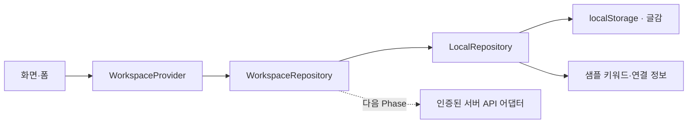

# Phase 0 아키텍처

## 기준과 가정

작업에 인용된 기존 SRS 및 상세 아키텍처는 현재 대화와 저장소에서 찾을 수 없었습니다. 사용자에게 추가 기준을 요청했으며, 별도 원문 없이 요청에 명시된 Phase 0 범위에 맞춰 다음 구조를 채택했습니다. 기존 SRS와 일치 여부를 검증한 것으로 간주하지 않습니다.

- React + TypeScript: 한국어 관리자 워크스페이스와 명시적인 데이터 모델
- Vite: 로컬 개발, 정적 빌드, 기존 Cloudflare Pages와 연결 가능한 `dist`
- React Router: 직접 주소 접근 및 화면 전환
- CSS: 외부 UI 프레임워크 없이 반응형 레이아웃과 공통 스타일
- Lucide: 일관된 아이콘
- Vitest + Testing Library: 저장소 계약과 사용자 흐름 검증
- Playwright: 실제 브라우저의 반응형·다이얼로그·새로고침 검증

## 데이터 흐름

`main.tsx`에서 저장소 구현을 주입합니다. 화면은 `localStorage`, API 키, 공급자별 응답 형식에 직접 의존하지 않습니다. 서버 연동 시 `WorkspaceRepository`를 구현하는 어댑터와 실제 인증 흐름을 추가합니다. `KeywordAnalysisGateway`, `ContentGenerationGateway`는 타입 계약만 제공하며 실행 구현은 없습니다.

## 모델

- `Idea`: 제목, 핵심 키워드, 카테고리, 진행 상태, 메모, 생성·수정 일시
- `IdeaStatus`: `inbox` → `planned` → `drafting` → `published`. 상태 변경은 사용자의 기록이며 실제 발행 요청이 아닙니다.
- `Keyword`: 샘플 월간 검색량, 상승률, 경쟁도, 기회 점수, 검색 의도, 추이, 연관어. 출처는 `sample`로 명시합니다.
- `Connection`: 연결할 서비스의 표시 정보. Phase 0 상태는 `planned`뿐입니다.

## 로컬 저장과 오류 처리

저장 형식은 `{ version: 1, ideas: Idea[] }`이며 키는 `prismkit.workspace.v1`입니다. 저장소가 없을 때 샘플을 읽고 첫 변경에서 저장합니다. 빈 배열이 저장된 경우 샘플을 다시 생성하지 않습니다.

입력 검증은 제목 1~120자, 키워드 1~60자, 메모 최대 2,000자와 허용된 카테고리·상태를 확인합니다. 공백을 정리하고, 수정 시 생성 일시를 보존합니다. 기존 JSON·스키마·중복 ID가 잘못되면 덮어쓰지 않고 복구 안내를 표시합니다. 용량 초과 또는 저장 차단 시 성공 알림을 표시하지 않으며 폼 값을 유지합니다. 다른 탭의 저장소 변경은 `storage` 이벤트로 반영합니다.

다중 사용자 트랜잭션이나 동시 수정 충돌 해결은 제공하지 않습니다. 서버 저장을 추가할 때 버전 필드 또는 ETag 등 동시성 제어를 도입해야 합니다.

## UI

- 800px 이하에서는 접을 수 있는 메뉴를 사용하고, 좁은 화면의 테이블·보드는 내부에서 가로 스크롤합니다.
- 다이얼로그는 브라우저의 네이티브 `dialog`를 사용합니다. Escape 닫기, 배경 포커스 제한, 포커스 복귀를 활용합니다.
- 본문 건너뛰기, 입력 레이블, 버튼 이름, 상태 알림, 모션 축소 설정을 제공합니다.
- 지표와 차트는 샘플임을 표시합니다. 실제 수집이나 분석 중이라고 오인할 진행 연출은 없습니다.

## 다음 Phase 경계

실제 데이터 공급자의 사용 조건·요금·API 권한을 확인한 뒤 서버 측 인증·비밀정보 보관, 수집 작업, 데이터베이스, 실제 분석 및 생성 기능을 설계합니다. Cloudflare 계정 설정과 SRS 원문도 다시 대조해야 합니다. Phase 0는 이 작업을 실행하지 않습니다.
